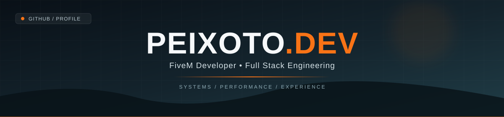

<div align="center">



<br>

**Desenvolvimento de sistemas, scripts e experiências para FiveM — do backend à interface.**


[](https://github.com/Peixotou)
[](https://github.com/Peixotou?tab=repositories)


</div>

---

### 👨‍💻 Sobre

Sou **Peixoto**, desenvolvedor com foco em **FiveM** e aplicações **Full Stack**.

Trabalho com a construção e evolução de recursos personalizados, integração entre interfaces e backend, persistência de dados e manutenção de sistemas. Meu foco é entregar soluções bem estruturadas, fáceis de manter e eficientes em produção.

```text
FOCUS  FiveM resources • Full Stack • APIs • Databases
STACK  Java • JavaScript • CSS • C# • C++ • Python • Lua • Rust • SQL
GOAL   Código consistente, performance e boa experiência de uso
```

### 🚀 O que eu desenvolvo

<table>
<tr>
<td width="33%" valign="top">

**⚙️ Sistemas FiveM**

Recursos e mecânicas personalizadas para servidores de roleplay.

</td>
<td width="33%" valign="top">

**🖥️ Interfaces NUI**

HUDs, painéis e aplicações web integradas ao jogo.

</td>
<td width="34%" valign="top">

**🗄️ Banco de dados**

Modelagem, consultas e integração com MySQL/MariaDB e PostgreSQL.

</td>
</tr>
<tr>
<td valign="top">

**⚡ Otimização**

Análise de desempenho, profiling e redução de consumo desnecessário.

</td>
<td valign="top">

**🔐 Segurança**

Validações server-side, permissões e proteção de eventos.

</td>
<td valign="top">

**🔌 Integrações**

APIs REST, automações e comunicação entre serviços.

</td>
</tr>
</table>

### 🎯 Áreas de atuação

| Desenvolvimento FiveM | Engenharia Full Stack | Infraestrutura & dados |
|:--|:--|:--|
| Lua, natives e eventos | React, Node.js e APIs | SQL, Git e deploy |
| Client/server, NUI e frameworks | Arquitetura e manutenção | Logs, backups e diagnóstico |
| Recursos personalizados e otimização | Integração frontend/backend | Segurança e desempenho |

### 🧰 Tecnologias & ferramentas

<div align="center">

**Linguagens**


**Frontend & Backend**


**SQL, bancos de dados & infraestrutura**


<sub>Ferramentas usadas ou estudadas; experiência varia por tecnologia.</sub>

</div>

### 🛠️ Meu jeito de trabalhar

| 01 · Planejar | 02 · Desenvolver | 03 · Validar | 04 · Entregar |
|:--|:--|:--|:--|
| Requisitos claros e escopo definido | Código organizado e componentizado | Testes, logs, segurança e performance | Documentação e manutenção |

### 📌 Projetos & evolução

Atualmente, meu foco é evoluir um portfólio de **recursos FiveM**, **interfaces NUI** e **aplicações Full Stack**. Os projetos públicos aparecerão na aba de repositórios conforme forem publicados.

[**→ Ver meus repositórios**](https://github.com/Peixotou?tab=repositories)

### 📬 Vamos conversar

Aberto a projetos, colaborações e troca de conhecimento sobre desenvolvimento para FiveM, sistemas web e integrações.

[](https://github.com/Peixotou)

<div align="center">
  <sub>PEIXOTO.DEV · FiveM / Full Stack / Engineering</sub>
</div>
